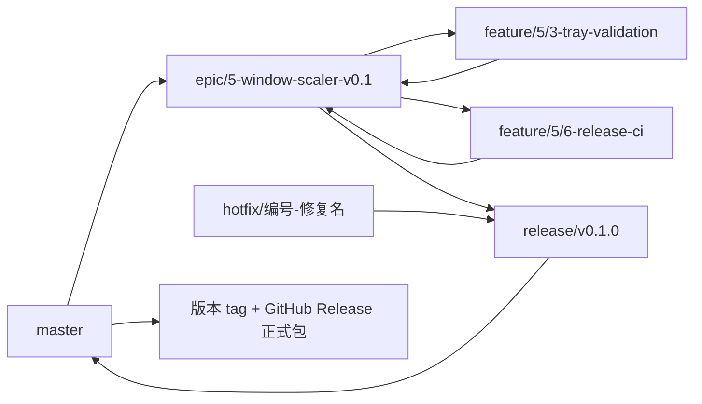

# 分支与正式发布

用户于2026-11-08确认主分支使用 `master`，采用以下开发分支。

| 分支 | 用途 | 来源与合并方向 |
| --- | --- | --- |
| `master` | 已集成的发布主线 | 接收 `release` PR |
| `epic/<Epic编号>-<名称>` | 集成一个大功能 | 从master创建，接收所属多个feature，验收后创建release |
| `feature/<Epic编号>/<Issue编号>-<名称>` | 独立小功能 | 从对应epic创建，合回同一epic |
| `hotfix/<Issue编号>-<名称>` | 修复问题 | 从待修复的epic或release创建并合回；修复已发布版本时从master创建补丁release，再合入修复 |
| `release/v<主.次.修订>` | 版本验收、打包与正式发布 | 从就绪epic或master创建，经PR合入master |

例如：`feature/5/3-tray-validation`、`feature/5/6-release-ci`均属于 `epic/5-window-scaler-v0.1`。Feature使用GitHub原生子任务关联同一Epic。



## 开发

1. 读取对应Issue，确认所属Epic和验收条件。
2. 从对应Epic创建feature；一个小功能一个Issue及分支。修复则使用hotfix。
3. 提交引用Issue，创建PR到对应Epic；通过检查并满足验收后合并。
4. Epic集成完成后创建版本化release；发布修复也通过release进入master，并同步到仍在开发的Epic。

分支流向由 `Branch policy` 检查；feature不能直接合入master，也不能合入其他Epic。可通过master到Epic的同步PR带入已发布修复。

## Release CI

1. 在就绪的代码上设置 `Cargo.toml` 与 `Cargo.lock` 的版本，创建同版本 `release/vX.Y.Z`。
2. 推送release或向master创建PR，`Release CI`自动执行格式检查、Clippy、Windows Release模式测试及优化构建，生成可下载的Actions测试产物。
3. 完成对应Release Issue中的实机验收；CI通过后合并release PR到master。
4. master工作流确认当前提交来自同仓库的版本化release PR，重新构建该提交，创建 `vX.Y.Z` 标签，将全部文件上传到草稿Release，最后公开为正式Release。

正式附件包括：Windows x64 ZIP、`WindowScaler.exe`、`SHA256SUMS.txt`和`build-info.json`。CI使用静态MSVC运行库；ZIP包含可执行文件和使用文档，不包含编译缓存。

版本名必须为稳定的三段版本号，且与Cargo一致。feature、epic、普通master提交和手动“Run workflow”只进行验证，不发布正式包。上传失败保留草稿；重跑只恢复同一提交拥有的草稿，已公开版本和指向其他提交的tag不会覆盖。

Latest使用GitHub的`legacy`版本判定，避免旧版构建晚完成时强制替换新版。草稿通过带身份验证的分页Release列表恢复，参见 [GitHub Release API](https://docs.github.com/en/rest/releases/releases)。push和PR使用不同并发组，避免相互取消。

首次仓库流程安装使用一次性的 `release/ci-setup`，同样经过master PR与Windows打包验证，但不创建应用版本tag或正式Release。它用于把CI本身安装到默认分支，不能替代版本化发布。

## 本地验证CI逻辑

在PowerShell 7中运行：

```powershell
node --test ci/*.test.mjs
.\build.ps1 -Mode test-release
.\build.ps1 -Mode release
.\ci\package.ps1 -Version 0.1.0
```

本地默认构建验证功能；正式CI构建额外使用 `RUSTFLAGS=-C target-feature=+crt-static`。本地打包文件位于被忽略的 `artifacts/`，不会自动上传或创建Release。
